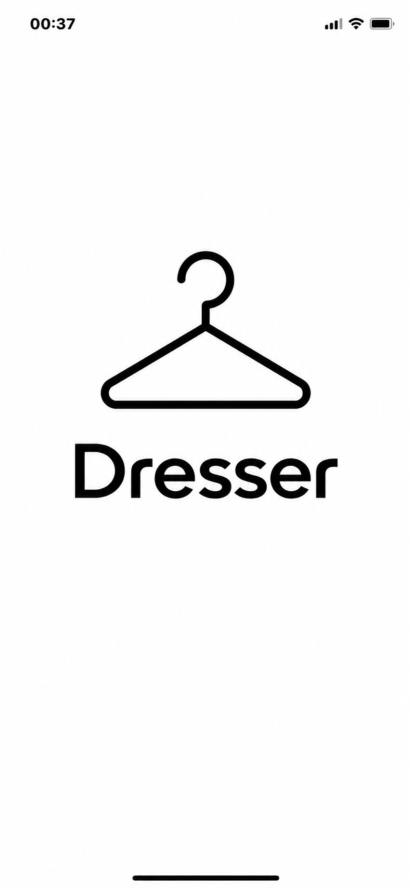
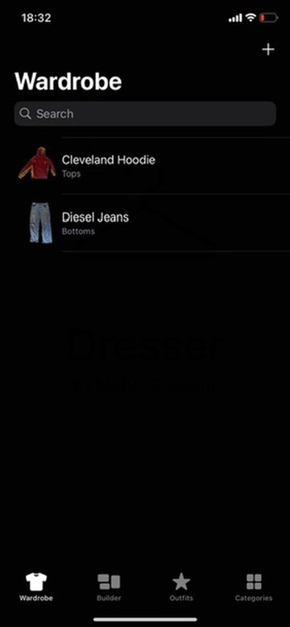
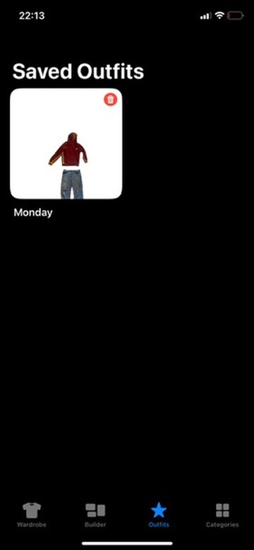
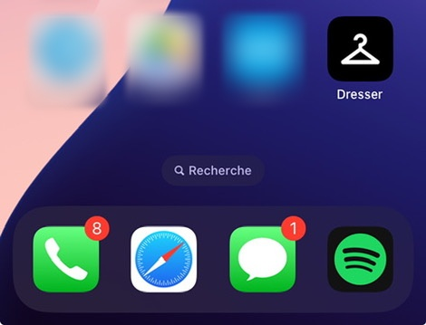

<div align="center">

# Dresser

### Your wardrobe, your looks — in one place.

**An iOS wardrobe organizer and outfit planner.**  
Designed as a clean, minimal experience for everyday outfit planning.

[](https://developer.apple.com/ios/)
[](https://developer.apple.com/xcode/)
[](https://github.com/msoulamibelhaj/dresser)



</div>

---

## Overview

**Dresser** is a personal iPhone application for keeping track of clothes and organizing outfits through an uncluttered mobile interface.

The app includes a wardrobe inventory, a search field, an **Outfits** view for saved combinations, and navigation tabs for **Wardrobe**, **Builder**, **Outfits**, and **Categories**.

## App gallery

| Wardrobe | Saved outfits |
|:---:|:---:|
|  |  |
| Clothing list and search | Your saved looks |

| Home screen | Launch screen |
|:---:|:---:|
|  |  |
| Dresser app icon (other apps blurred) | Updated logo and wordmark |

## Features

- **Wardrobe management:** Browse clothing items with thumbnail images, names, and categories.
- **Search:** Find garments from the wardrobe screen.
- **Saved outfits:** View previously saved combinations with day labels.
- **Four-tab navigation:** Wardrobe, Builder, Outfits, and Categories.
- **Minimal identity:** Custom hanger icon, matching launch screen, dark-mode in-app interface.

> The screenshots establish the visible interface. A full video demonstration and deeper implementation details can be added later. The Builder and Categories screens are shown as navigation tabs, but their internal workflows are not documented here.

## Tech & setup

- **Platform:** iOS / iPhone
- **Development:** Xcode project (`Dresser.xcodeproj`)
- **Interface resources:** Storyboards and asset catalogs (`Assets.xcassets`)

To run locally:

```bash
git clone https://github.com/msoulamibelhaj/dresser.git
```

Open `Dresser.xcodeproj` in Xcode on macOS, choose a simulator or connected iPhone, configure signing if necessary, and run the app.

## Video demo

Coming soon.

## Author

Made by [Mehdi Soulami](https://github.com/msoulamibelhaj).
